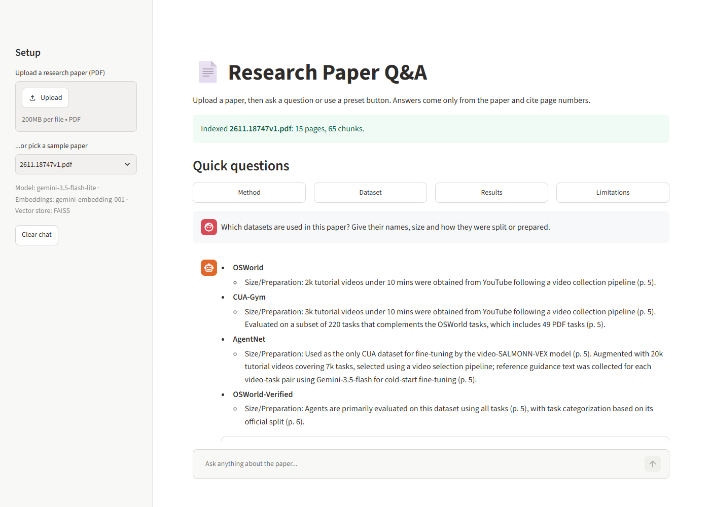
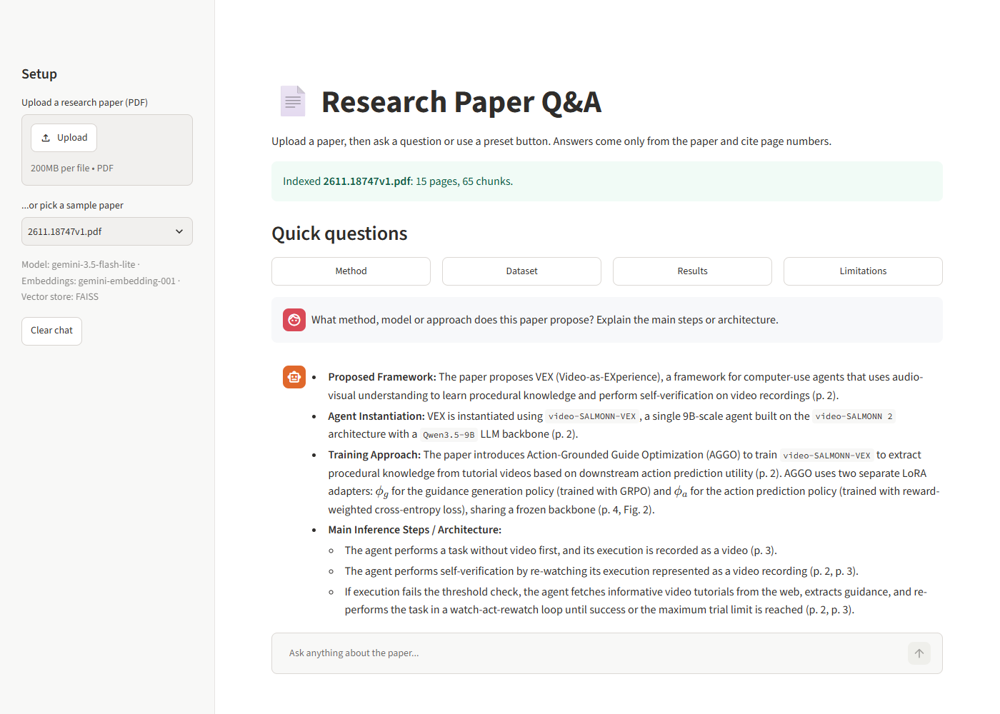
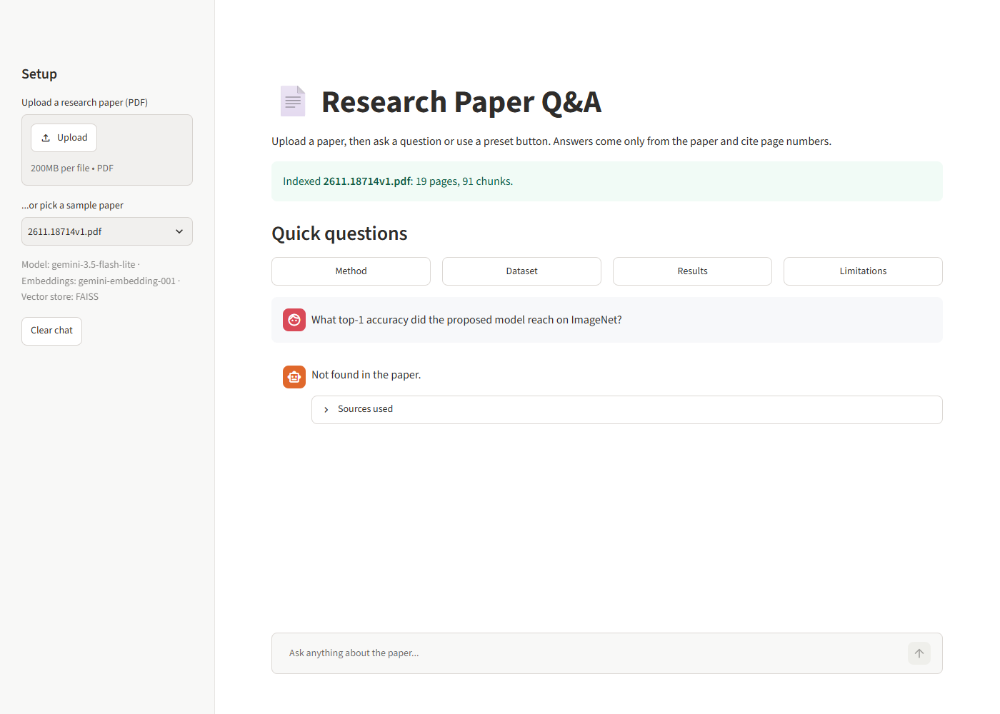

# PS36 – Research Paper Q&A (LLM Mini Project)

**Name:** Sandesh Mutadak · **Roll No:** 36 · **PRN:** ADT23SOCB0965 · MIT ADT University

**Problem statement:** Students read many papers for a literature review. This app lets you upload a research paper (PDF) and ask questions about its method, dataset and results. Answers are grounded in the paper and cite page numbers.

## Features
- Upload any text-based research paper PDF, or pick one from `samples/`
- RAG pipeline: PDF → overlapping chunks → Gemini embeddings → FAISS → Gemini Flash
- Four preset buttons (**Method, Dataset, Results, Limitations**), each sending a fixed question
- Free-text chat for anything else
- Retrieval uses keyword hints per preset and the top 8 chunks
- Page-number citations, plus a "Sources used" panel that shows the retrieved chunks and similarity scores
- Replies "Not found in the paper." instead of guessing
- Model fallback: if a Gemini model is retired (404) or overloaded (503/504), the next model in the list is tried automatically

## Tech stack
Python · Streamlit · Google Gemini API (`gemini-3.5-flash` / `gemini-3.5-flash-lite`, `gemini-embedding-001`) · FAISS · pypdf

## How to run
```bash
pip install -r requirements.txt
cp .env.example .env        # then paste your Gemini API key into .env
streamlit run app.py
```
On Windows you can just double-click `run_app.bat`. Get a free API key at https://aistudio.google.com/apikey.

## Project structure
```
app.py                Streamlit UI (upload / sample picker, preset buttons, chat, sources)
rag.py                PDF reading, chunking, embeddings, FAISS search, prompt, model fallback
make_screenshots.py   Runs 5 test questions in a headless browser and saves screenshots
requirements.txt
.env.example          Template for the API key (the real .env is git-ignored)
screenshots/          Test outputs
```

## Screenshots
All five test outputs are in `screenshots/` (generated with `make_screenshots.py`).

**Dataset preset:**



**Method preset:**



**Question not answered by the paper:**


